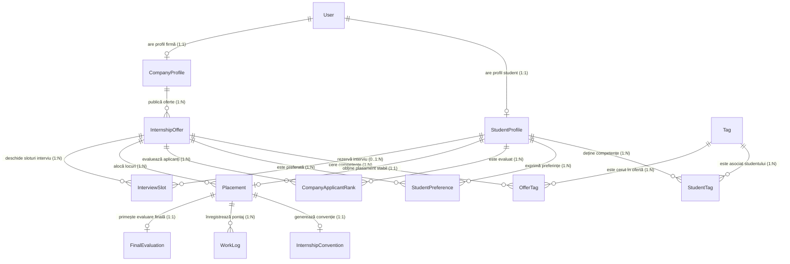

# Contracte de Date și Arhitectură (Data Models & Contracts)

Acest document descrie schema bazei de date, taxonomiile și contractele de securitate/date pentru **P14 - Portal de Practică**.

## 1. Tabele Principale

| Tabel Prisma | Tabel BD (PostgreSQL) | Rol / Descriere | Constrângeri cheie |
|---|---|---|---|
| `User` | `users` | Utilizatori autentificabili și roluri sistem | `email` UNIQUE, Enum `UserRole` (STUDENT, COMPANY_TUTOR, COORDINATOR, ADMIN) |
| `StudentProfile` | `student_profiles` | Profil academic, social bio și profesional student | `userId` UNIQUE (1:1 cu User), `cvUrl`, `githubUrl`, `linkedinUrl` |
| `CompanyProfile` | `company_profiles` | Profil companie parteneră | `userId` UNIQUE (1:1 cu User), `cuiCif` UNIQUE |
| `Tag` | `tags` | Taxonomie competențe (predefinite pe domenii Inginerie + custom) | `name` UNIQUE, Enum `EngineeringDomain`, `isPredefined` |
| `StudentTag` | `student_tags` | Asociere N:M student - tag cu nivel de competență | UNIQUE(`studentId`, `tagId`), `proficiencyLevel` (BEGINNER, INTERMEDIATE, ADVANCED) |
| `OfferTag` | `offer_tags` | Asociere N:M ofertă - tag cu obligativitate | UNIQUE(`offerId`, `tagId`), `isRequired`, `weight` |
| `InternshipOffer` | `internship_offers` | Oferte de practică propuse de companii | FK `companyId`, `slotsTotal`, `slotsAvailable`, `status` |
| `StudentPreference` | `student_preferences` | Lista ordonată de preferințe ale studentului | UNIQUE(`studentId`, `offerId`), UNIQUE(`studentId`, `rank`) |
| `CompanyApplicantRank` | `company_applicant_ranks` | Clasamentul aplicanților stabilit de firmă | UNIQUE(`offerId`, `studentId`), `rank`, `status` |
| `Placement` | `placements` | Rezultatul stabil al algoritmului de matching | `studentId` UNIQUE (max 1 loc/student), FK `offerId`, status |
| `InternshipConvention` | `internship_conventions` | Convenții de practică generate ca PDF | `placementId` UNIQUE, `conventionNumber` UNIQUE, `prefilledData` (JSONB) |
| `WorkLog` | `work_logs` | Jurnal / pontaj săptămânal ore de practică | FK `placementId`, `date`, `hoursWorked`, `status`, validare tutore |
| `InterviewSlot` | `interview_slots` | Programare sloturi de interviu companie-student | FK `offerId`, FK opțional `studentId`, `isBooked` |
| `FinalEvaluation` | `final_evaluations` | Fișa de evaluare finală a stagiului | `placementId` UNIQUE, `grade`, `feedback`, `competenciesAcquired` |

## 2. Diagrame de Relații (ERD)



## 3. Domeniile Facultății de Inginerie (Taxonomie Tag-uri)

Enum `EngineeringDomain`:
- `COMPUTER_SCIENCE_IT`: Calculatoare și Tehnologia Informației (ex: React, Next.js, Node.js, Python, PostgreSQL, Docker, AI/ML, CyberSec)
- `ELECTRONICS_TELECOM`: Inginerie Electronică și Telecomunicații (ex: Embedded C, Arduino, ESP32, PCB Design, Telecom, IoT)
- `ROBOTICS_MECHATRONICS`: Mecatronică și Robotică (ex: CAD/SolidWorks, PLC Siemens, ROS, Automatizări, Pneumatică)
- `INDUSTRIAL_MANAGEMENT`: Inginerie Industrială / Tehnologică (ex: Lean Manufacturing, Six Sigma, ERP, Calitate, Logistică)
- `GENERAL_ENGINEERING`: Discipline inginerești generale (ex: Matematică aplicată, Fizică, Algoritmi, Management de proiect)

Tag-urile pot fi marcate ca:
- `isPredefined = true`: Tag-uri standard din nomenclatorul facultății.
- `isPredefined = false`: Custom tags adăugate de studenți sau firme.

## 4. Contractul de Confidențialitate (CV Privacy Gate)

**Regulă de securitate**: *CV-ul detaliat (`cvUrl`) și datele de contact directe (telefon, adresă) ale unui student sunt accesibile reprezentanților companiei **DOAR DACĂ** studentul a aplicat explicit la poziția respectivă.*

Interfață de verificare (în `src/lib/permissions.ts`):
```typescript
export async function canCompanyViewStudentCv(
  companyUserId: string,
  studentId: string,
  offerId?: string
): Promise<boolean> {
  // 1. Găsește compania asociată user-ului curent
  // 2. Verifică dacă există cel puțin o înregistrare în StudentPreference sau CompanyApplicantRank
  //    prin care studentul a aplicat la o ofertă deținută de această companie.
  // 3. Returnează true doar dacă există o aplicație activă.
}
```

## 5. Motorul de Recomandare & Scor de Compatibilitate

Scorul de compatibilitate $Score \in [0, 100]\%$ este calculat bidirecțional:
- Pentru student: indică relevanța fiecărei oferte disponibile în feed.
- Pentru companie: sugerează candidați potriviți pentru pozițiile deschise.

Calcul:
$$Score = \left( \frac{\sum_{t \in T_{req} \cap T_{stud}} w(t)}{\sum_{t \in T_{req}} w(t)} \times 70\% \right) + \left( \frac{\sum_{t \in T_{opt} \cap T_{stud}} w(t)}{\sum_{t \in T_{opt}} w(t)} \times 20\% \right) + \left( DomainMatch \times 10\% \right)$$

Unde:
- $T_{req}$ sunt tag-urile obligatorii ale ofertei (`isRequired: true`).
- $T_{opt}$ sunt tag-urile opționale (`isRequired: false`).
- $T_{stud}$ sunt tag-urile din profilul studentului (ponderate opțional după nivelul de competență).
- $DomainMatch$ este $1.0$ dacă domeniul de studiu corespunde categoriei ofertei, altfel $0.0$.
